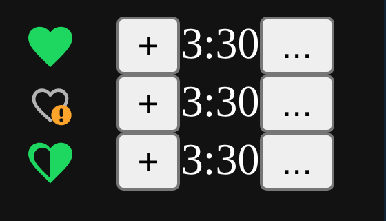

# Old Like Button

Brings back Spotify's classic heart, on every track list and in the now-playing bar, right next to the new "+" / tick.


## Features

- **Everywhere:** playlists, albums, artist pages, search, the queue, and the now-playing bar (bottom left). The heart sits directly to the left of Spotify's "+" / tick.
- **See your liked songs at a glance:** liked songs always show a filled heart, not only on hover. Empty hearts appear on hover, the same way the "+" does (this can be changed, see Settings).
- **Other versions:** a half-heart means you've liked a different version of the same recording, such as a remaster, a live version or a compilation. Hover over it to see which ones, or right-click the song and choose **Show liked versions of this recording** to jump to them.
- **Hidden likes:** an outline heart with an orange **!** means you liked this song before Spotify changed its ID (this happens when an album is re-uploaded). Spotify keeps the old like but no longer shows it. Click the heart to like the current copy.
- **Multi-select:** select several rows (Shift-click or Ctrl-click) and click the heart on any selected row to like or unlike all of them.
- **Stays in sync:** picks up likes you make on your phone or in the web player within about 30 seconds.



*Liked · hidden like (ID changed) · liked in another version*

## Install

**Marketplace:** search for **Old Like Button** in the Extensions tab and click Install.

**Manual:**
1. Run `spicetify config-dir` and copy `oldLikeButton.js` into the `Extensions` folder.
2. Run:
   ```
   spicetify config extensions oldLikeButton.js
   spicetify apply
   ```

If you have another "Old Like Button" extension installed, remove it first, otherwise every row gets two hearts.

## Settings

Open `oldLikeButton.js` and change these values at the top, then run `spicetify apply`:

| Setting | Default | What it does |
| --- | --- | --- |
| `SHOW_EMPTY_HEARTS_ALWAYS` | `false` | `true` shows empty hearts on every row all the time. |
| `REMOVE_LEFTOVER_LIKES_WHEN_LIKING` | `false` | `true` also deletes the hidden old copy when you re-like a song whose ID changed. |
| `SHOW_OWN_TOASTS` | `false` | `true` shows the extension's own "Added to Liked Songs" message. Spotify already shows one. |

## Compatibility

Tested on Spotify 1.3.6 with Spicetify 2.xx.x. Spotify updates often rename parts of the app; if something stops working, please open an issue.

## Troubleshooting

Open DevTools (run `spicetify enable-devtools` first, then press Ctrl+Shift+I) and look in the Console for lines starting with `[Old Like Button]`. Include them in your issue.

## Credits

Inspired by and improved from [Old Like Button Revamped](https://github.com/K4HVH/spicetify-old-like-button-revamped) by K4HVH, which builds on the [original extension](https://github.com/Maskowh/spicetify-old-like-button-extension) by Maskowh and OhItsTom. MIT licensed. See [LICENSE](LICENSE).
